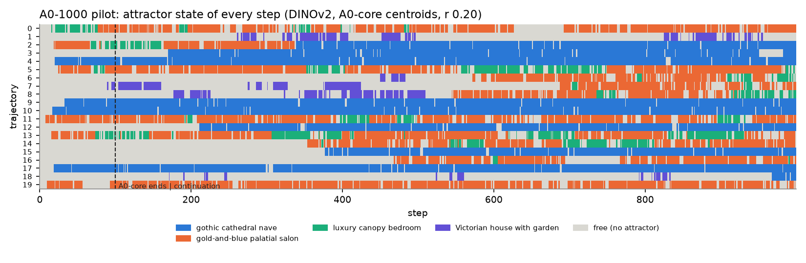
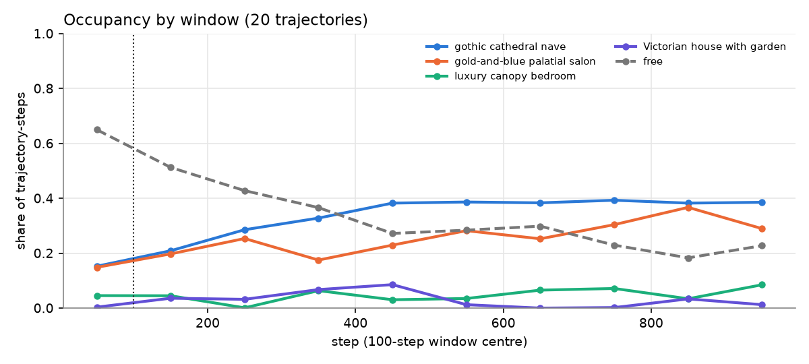
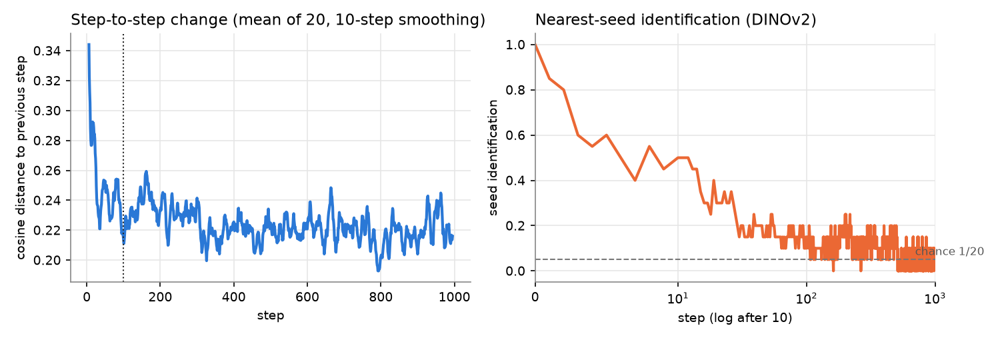
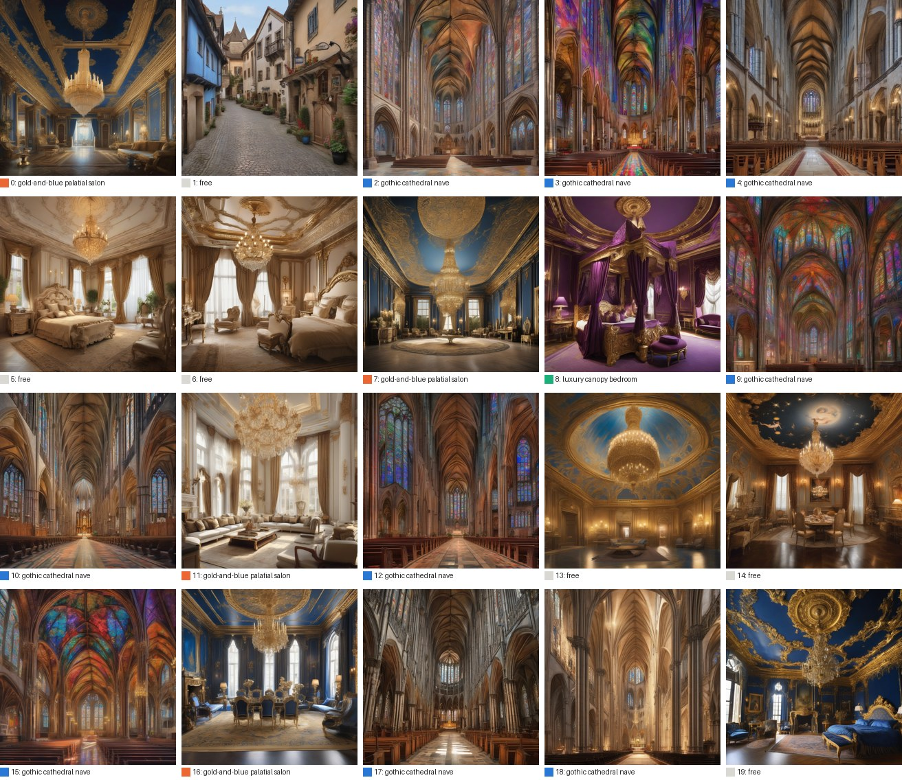

# A0-1000 pilot gate (trajectories 0–19, steps 100–999)

**Gate (run health): PASS.** All 20 trajectories reached step 999, the offload kept the pod volume at 26–27 of 50 GB, and no trajectory degenerated.
**Prediction: the stationarity hypothesis fails.** P1 FAIL, P2 PASS, P3 FAIL (on capture, and on substance: the cathedral is absorbing at the trajectory level), P4 FAIL (cathedral share), P5 PASS.

The 100-step picture is not the long-run picture. The *exit* rates are stationary: a trajectory inside a basin leaves it at the same per-step rate in every window. *Occupancy* is not stationary. The free population drains steadily into two regions, the gothic cathedral and the palatial interior (salon, canopy bedroom and their neighbours), and the cathedral is a one-way door: **all 9 trajectories that ever entered it are in it at step 999, and none has visited another attractor since its first entry.**

Prediction: predictions.md "A0-1000" (2026-11-10, Brad's, bands by Claude). Everything below is DINOv2 with A0-core's 8 step-99 centroids, fixed radius 0.20 and exit hysteresis 1.25×, exactly as in `gravity_a0_core.md`. Rebuild: `analysis/gravity.py a0_1000 --archive archive/a0_core_centroids.npz --labels archive/a0_core_names.json --trajs 0:20 --window LO:HI` for each window, then `analysis/a0_1000_pilot.py` (→ `reports/a0_1000_pilot_metrics.json`, figures in `reports/figures/a0_1000_pilot_*`). Graded by DINOv2; CLIP is not used.

## Predictions graded

| | prediction | measured | verdict |
|---|---|---|---|
| **P1** stability | free share within 0.10 of 0.71 in every window | 0.51, 0.43, 0.37, 0.27, 0.28, 0.30, 0.23, 0.18, 0.23 (windows 100–199 … 900–999) | **FAIL** |
| | salon and cathedral hazard and capture: 100–499 vs 500–999 within 1.5× | cathedral hazard 0.030 → 0.026, capture 0.0138 → 0.0166; salon hazard 0.099 → 0.108 (all pass); **salon capture 0.0276 → 0.0457 (1.66×)** | FAIL (1 of 4) |
| | pooled exit rate by window flat (within 1.5× of pooled) | 0.058–0.092 against a pooled 0.073 (max 1.26×) | pass |
| **P2** no new motif | every step-999 k-means cluster within 0.20 of an A0-core centroid; no new motif in ≥ 3 trajectories for ≥ 5 steps | knee k = 4: salon 0.045, cathedral 0.019, canopy bedroom 0.127; a singleton (trajectory 1) is 0.50 from the loose "old-town street / village" centroid, but its image is a cobblestone village street (on the A0 motif list). New motifs among free steps: luxury kitchen (2 trajectories), horse racing (1). | **PASS** (the singleton fails the 0.20 rule but is a known, loose A0 motif) |
| **P3** cathedral not absorbing | no trajectory stays from its first late entry to 999 | no trajectory stays continuously inside r 0.20 (letter: pass), but every trajectory that entered stays in the region (below) | **FAIL** in substance |
| | mean residence 20–45 steps; longest completed visit < 200 | 34.9 (169 completed visits); 176 | pass |
| | capture within 2× of 0.0032 | 0.0153 (4.8×) | **FAIL** |
| **P4** endpoints | salon 20–50 %, cathedral 5–20 %, together ≥ 1/3 | salon 4/20 = 20 %, **cathedral 9/20 = 45 %**, together 65 % | **FAIL** |
| **P5** no seed memory | step-999 seed identification at chance (1/20) | 0.05 at step 999; mean 0.083 over steps 100–999 (DINOv2) | **PASS** |

One baseline note for P1: these 20 trajectories had a free share of 0.65 over steps 0–99, not the 0.71 of all 100. P1 fails against either number.

## The cathedral is a one-way door

| trajectory | first cathedral step | share of later steps inside r 0.20 | other attractors after first entry | median distance to centroid after entry |
|---|---|---|---|---|
| 10, 17, 4, 9 | 17, 19, 20, 33 (A0-core) | 0.97 each | none | 0.08 |
| 3, 12, 2, 15 | 170, 211, 339, 377 | 0.93, 0.94, 0.97, 0.96 | none | 0.08–0.09 |
| 18 | 968 | 0.94 | none | 0.10 |

- **Exits are edge flicker, not departures.** The 169 completed visits and the mean residence of 35 steps (P3's band) are excursions just past 1.25 × 0.20, followed by re-entry. 231 "free" steps cluster on a cathedral image (DINOv2 0.09 from the centroid). A0-core's per-visit statistics measure this flicker, not escape.
- **Capture is rare and one-way.** The 11 trajectories never captured did not come within 0.69 of the cathedral centroid after step 100. Among the 16 trajectories outside at step 99, 5 were captured in 11,465 at-risk steps: a first-entry rate of about **0.00044 per step** (Poisson 95 % CI 0.00014–0.0010), i.e. a mean time to capture of about 2,300 steps. The step-999 picture is therefore still a transient. If the rate holds, roughly 4 of the 11 would be captured by step 2,000.
- **The other region is the palatial interior.** The other 10 trajectories (0, 5, 6, 7, 8, 11, 13, 14, 16, 19) wander among the salon, the canopy bedroom and palatial rooms just outside the 0.20 radius; 5 of the 6 "free" endpoints are palatial bedrooms and salons. Trajectory 1 alone still wanders (village street, Victorian house, fantasy castle). At step 999, **19 of 20 trajectories are in one of the two regions.**

Cathedral occupancy rises from 0.15 (steps 0–99) to a plateau of about 0.38 by step 400; the free share falls from 0.65 to about 0.2. Endpoint diversity (Vendi of the 20 endpoints, DINOv2) falls from 13.5 at step 99 to 7.0 at step 499 and stays at 6.5–8.0 thereafter.

## Drift curves and seed memory

The loop never slows down. Step-to-step change is about 0.22 (cosine) in every window from 100 to 999 (0.255 over steps 0–99). No trajectory froze: the lowest 20-step mean change in any trajectory is 0.078. Seed identification reaches chance by step ~100 and stays there (P5).

## Endpoint contact sheets

Step 99 (A0-core): `figures/a0_1000_pilot_sheet_99.jpg`. Step 999: `figures/a0_1000_pilot_sheet_999.jpg` (trajectory number and state under each image).

## Run health, throughput and cost

| | |
|---|---|
| Steps | 18,000 trajectory-steps (20 × 900), 900 lockstep steps, every image and record verified on the laptop (sha256, 0 mismatches) |
| Throughput | **7.56 s per trajectory-step** (median 7.50; SDXL 5.2 s, LLaVA 2.0–2.5 s), 37.8 h of stepping, RTX A6000 48 GB, single pass (SDXL batch 16, 8 LLaVA slots) |
| Cost | **$22.97** billed for pod 0cu4w2a72mt5l9 through 2026-11-12 (GPU $22.60, disk $0.37; RunPod billing read), including setup, smoke and ~1 h idle after the finish; $1.24 of GPU time per 1,000 trajectory-steps |
| Captions | mean 140 words (median 130); 0 empty, 0 refusals; 4 `length_cutoff` runaways in 18,000 (0.22 per 1,000; gate limit 1); 2 captions under 20 words (normal content) |
| Images | none under 150 kB; no near-constant trajectory |
| Disk | pod volume 26–27 of 50 GB throughout; run working set ≤ 1.8 GB |

**Crash/resume log.** No runner crash or restart: a single `start` event (resumed at step 100, last_complete_step 99 for all 20) and a clean `finished`. One transient Ollama `ReadError` (bad file descriptor) on trajectory 13, step 922, retried after 5 s and succeeded (`caption_attempts` 2; the only retry in the run). On the laptop side, Windows rebooted the machine overnight on 2026-11-10/11 and killed the offload loop (last pass 00:13 PST); it was restarted at 07:53 PST and cleared the 3,666-image backlog in one pass with no data loss.

**Deviations.** D20 (continuation from A0-core's step 99) and its 2026-11-12 amendment: Ollama 0.40.16 with an 8,192-token context per slot (A0-core: 0.40.6, 32,768).

## What the rest costs, and what it would buy

The pilot answered the question it was run for: the 100-step picture is not stationary. What the remaining runs can still answer is the shape of the transient: how fast trajectories are captured, whether other one-way doors exist, and where the loop ends up.

| option | trajectory-steps | wall (A6000, 7.56 s) | cost | what it answers |
|---|---|---|---|---|
| **A. Full run** (the other 80, steps 100–999) | 72,000 | ~6.3 days | **~$92** (A6000 secure $0.59/h); ~$129 and ~2.2 days on an RTX PRO 6000 ($2.49/h at A0-core's 2.58 s) | First-entry rate with ~5× the events (CI roughly ±40 % instead of ×3); whether trajectories from the A0-core clusters the pilot has only one trajectory of (castle, people/art, village; 14 of the other 80 ended A0-core there) also drain into the two regions or find their own one-way doors; step-999 endpoint shares at 1 % resolution |
| **B. Pilot to step 1,999** (same 20) | 18,000 | ~1.6 days | **~$23** | The limit directly: are more of the 11 captured (≈ 4 expected), does the palatial region ever leak into the cathedral, does the occupancy plateau hold |
| **C. The 80 to step 499 only** | 32,000 | ~2.8 days | **~$41** | The drain phase (most of the change happens in 100–500) and the capture rate over 80 more trajectories, at less than half the price of A |

Prices are from the RunPod catalogue read on 2026-11-12: A6000 secure $0.59/h, stock LOW in EU-SE-1; RTX PRO 6000 secure $2.49/h, LOW in EU-RO-1 and US-NC-2. Each option needs its own prediction in predictions.md before it runs. B and C are new run directories seeded from `a0_1000` (D20 mechanics). On a run longer than about 3 days, the laptop offload loop is exposed to Windows reboots; a 100 GB volume disk instead of 50 GB would hold the whole 72,000-step run on the pod if the loop dies.

**Claude's recommendation:** B first. It is the cheapest test of the claim this pilot now makes (a one-way door toward a two-region end state). Then decide on A or C with B's numbers in hand.
