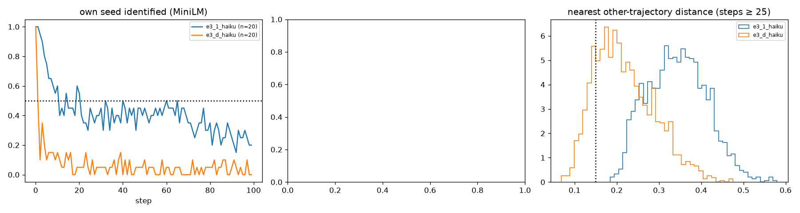

# E3-S (100 seeds) and E3-W (20-word summary): Haiku compress–expand

Predictions: predictions.md "E3 scale and bottleneck width" (2026-11-02). Pair-sharing rule and k scaling as stated there; anonymised = names → X (E3-A filter).

**D1 (abstraction converges): fails, 2 of 4 clauses** (shared raw 0 vs ≥ 3; half-life 1 vs ≤ 10; nn-other 0.208 vs ≤ 0.30; theme Vendi 6.8 vs ≤ half of 13.1).

## Cells

| cell | n | half-life | own seed 10 / 50 / 99 | nn-other raw / anon | within 0.15 raw / anon | Vendi story / summary at 99 | words at 99 | summary words (≤20 / ≤50) | top-10 cover | top names 50–99 | modal tuple (share) | woman / hopeful |
|---|---|---|---|---|---|---|---|---|---|---|---|---|
| e3_1_haiku | 20 | 11 | 0.6 / 0.45 / 0.2 | 0.342 / 0.262 | 0.000 / 0.004 | 9.5 / 13.1 | 502 | 50.0 (0.00 / 0.55) | 0.54 | Maya 200, Nora 55, Daniel 52, Priya 43, Mara 39 | young_adult × internal × hopeful (0.16) | 0.70 / 0.73 |
| e3_d_haiku | 20 | 1 | 0.15 / 0.1 / 0.0 | 0.208 / 0.170 | 0.177 / 0.316 | 6.9 / 6.8 | 456 | 19.0 (0.77 / 1.00) | 0.53 | Daniel 131, Maya 87, Ruth 64, Thomas 56, Marcus 46 | middle_aged × interpersonal × hopeful (0.28) | 0.75 / 0.80 |

## E3-W: joint atlas with e3_1_haiku (k 40)

| atlas | width persistent (shared, pairs) | base persistent (shared, pairs) | clusters visited by both cells |
|---|---|---|---|
| raw | 1 (0, 0) | 15 (0, 0) | 0 |
| anon | 9 (8, 72) | 16 (0, 0) | 5 |

Shared-cluster sheets: `sw_cluster_e3_d_haiku_raw.md`, `sw_cluster_e3_d_haiku_anon.md`.

## Verdicts

- **D1_abstraction_converges**: {"shared_raw": 0, "shared_anon": 8, "need_shared": 3, "shared_ok": false, "base_shared_raw": 0, "half_life": 1, "base_half": 11, "half_le_10": true, "nn_other": 0.2075464809348434, "base_nn": 0.34229522727353434, "nn_le_030": true, "within_015": 0.17666666666666667, "vendi_theme_99": 6.77131603587252, "base_vendi_summary_99": 13.120986175822729, "vendi_half": false, "cover": 0.534, "base_cover": 0.5416248746238717, "words": 456.0, "theme_words_median": 19.0, "theme_le25": 0.993, "n_clauses_hold": 2, "holds": false}
- **D_theme_layer_posthoc**: {"modal": ["middle_aged", "interpersonal", "hopeful"], "base_modal": ["young_adult", "internal", "hopeful"], "modal_share": 0.281, "base_modal_share": 0.164, "woman": 0.754, "base_woman": 0.696, "hopeful": 0.803, "base_hopeful": 0.733}

