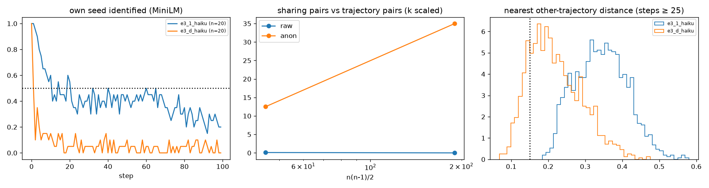

# E3-S (100 seeds) and E3-W (20-word summary): Haiku compress–expand

Predictions: predictions.md "E3 scale and bottleneck width" (2026-11-02). Pair-sharing rule and k scaling as stated there; anonymised = names → X (E3-A filter).

**Speculation 1 (numerous wells): in between: sharing pairs present but no well reused by >= 4 (W > 500 at this n).** S1_wells_numerous fails; S2_replication_first20 fails; S3_density fails; S4_seed_trace fails

## Cells

| cell | n | half-life | own seed 10 / 50 / 99 | nn-other raw / anon | within 0.15 raw / anon | Vendi story / summary at 99 | words at 99 | summary words (≤20 / ≤50) | top-10 cover | top names 50–99 | modal tuple (share) | woman / hopeful |
|---|---|---|---|---|---|---|---|---|---|---|---|---|
| e3_1_haiku | 20 | 11 | 0.6 / 0.45 / 0.2 | 0.342 / 0.262 | 0.000 / 0.004 | 9.5 / 13.1 | 502 | 50.0 (0.00 / 0.55) | 0.54 | Maya 200, Nora 55, Daniel 52, Priya 43, Mara 39 | young_adult × internal × hopeful (0.16) | 0.70 / 0.73 |
| e3_d_haiku | 20 | 1 | 0.15 / 0.1 / 0.0 | 0.208 / 0.170 | 0.177 / 0.316 | 6.9 / 6.8 | 456 | 19.0 (0.77 / 1.00) | 0.53 | Daniel 131, Maya 87, Ruth 64, Thomas 56, Marcus 46 | older_adult × internal × hopeful (0.18) | 0.77 / 0.76 |

## E3-S: pair sharing at n = 20 (k 40)

| atlas | persistent | shared (≥ 2 traj) | sharing pairs / pairs | rate | max trajectories in one cluster | W-hat | steps inside |
|---|---|---|---|---|---|---|---|
| raw | 1 | 0 | 0 / 190 | 0.0000 | 0 | None | 0.01 |
| anon | 8 | 7 | 35 / 190 | 0.1842 | 5 | 5 | 0.25 |

Random 20-trajectory subsamples (5, k 40): shared clusters median raw 0 (IQR [0.0, 0.0]), anon 7 (IQR [7.0, 7.0]); mean sharing pairs raw 0.00, anon 35.00; largest multiplicity raw 0, anon 5. The 20-trajectory cell e3_1_haiku had 0 shared (raw).

Sharing pairs vs n (mean over 10 draws, k scaled): n 10: raw 0.1, anon 12.5 of 45; n 20: raw 0.0, anon 35.0 of 190. A fixed well count gives pairs ∝ n(n−1)/2.

Fresh sample of seeds 0–19: half-life 1 (20-trajectory subsample median over all 100: 1, IQR [1.0, 1.0]); nn-other 0.208; words 456; top-10 cover 0.53, top names Daniel 131, Maya 87, Ruth 64, Thomas 56, Marcus 46; modal tuple older_adult × internal × hopeful (0.17).

Same-seed check (base vs scale, seeds 0–19, steps 50–99, median nearest-step distance): same-seed 0.425 vs different-seed 0.428 (gap 0.003; anonymised gap -0.008); 0 of 20 same-seed pairs share a persistent cluster in the joint atlas (k 79, 0 shared clusters, 0 sharing pairs).

Shared-cluster sheets: `sw_cluster_e3_d_haiku_raw.md`, `sw_cluster_e3_d_haiku_anon.md`.

## Verdicts

- **S1_wells_numerous**: {"anon_sharing_pairs": 35, "anon_rate": 0.18421052631578946, "anon_shared_clusters": 7, "anon_max_mult": 5, "raw_shared_clusters": 0, "raw_sharing_pairs": 0, "W_hat_anon": 5.428571428571429, "sub_raw_shared_median": 0.0, "sub_anon_shared_median": 7.0, "holds": false, "fails": false}
- **S2_replication_first20**: {"half_life": 1, "half_in_8_15": false, "cover": 0.534, "cover_in_band": true, "top_name": "Daniel", "maya_top": false, "words": 456.0, "words_in_band": false, "modal": ["older_adult", "internal", "hopeful"], "base_modal": ["young_adult", "internal", "hopeful"], "modal_same": false, "all100": {"half_life_sub_median": 1.0, "cover": 0.534, "words": 456.0}, "holds": false}
- **S3_density**: {"nn_other": 0.2075464809348434, "base_nn": 0.34229522727353434, "nn_in_band": false, "within_015": 0.17666666666666667, "within_in_band": false, "holds": false, "continuum": false}
- **S4_seed_trace**: {"gap_raw": 0.003296916372719949, "gap_anon": -0.007614948723203896, "gap_in_band": false, "same_seed_pairs_sharing": 0, "le_1": true, "holds": false}
- **speculation_1**: in between: sharing pairs present but no well reused by >= 4 (W > 500 at this n)

