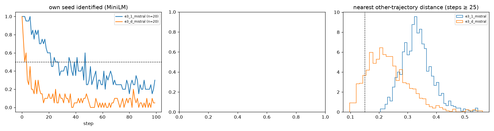

# E3-S (100 seeds) and E3-W (20-word summary): Haiku compress–expand

Predictions: predictions.md "E3 scale and bottleneck width" (2026-11-02). Pair-sharing rule and k scaling as stated there; anonymised = names → X (E3-A filter).

**D1 (abstraction converges): fails, 3 of 4 clauses** (shared raw 0 vs ≥ 2; half-life 2 vs ≤ 10; nn-other 0.223 vs ≤ 0.30; theme Vendi 5.5 vs ≤ half of 12.2).

## Cells

| cell | n | half-life | own seed 10 / 50 / 99 | nn-other raw / anon | within 0.15 raw / anon | Vendi story / summary at 99 | words at 99 | summary words (≤20 / ≤50) | top-10 cover | top names 50–99 | modal tuple (share) | woman / hopeful |
|---|---|---|---|---|---|---|---|---|---|---|---|---|
| e3_1_mistral | 20 | 22 | 0.85 / 0.3 / 0.3 | 0.330 / 0.220 | 0.000 / 0.019 | 9.1 / 12.2 | 388 | 58.0 (0.00 / 0.24) | 0.50 | Meadowgrove 68, Amelia 67, Mia 56, Aurora 50, Eldoria 46 | unclear × social_or_community × hopeful (0.33) | 0.34 / 0.88 |
| e3_d_mistral | 20 | 2 | 0.3 / 0.05 / 0.05 | 0.223 / 0.171 | 0.111 / 0.361 | 7.3 / 5.5 | 419 | 24.0 (0.40 / 0.99) | 0.37 | Meadowgrove 76, Elara 49, Elderglen 46, Harmonyville 44, Harmonia 31 | unclear × social_or_community × hopeful (0.42) | 0.47 / 0.98 |

## E3-W: joint atlas with e3_1_mistral (k 40)

| atlas | width persistent (shared, pairs) | base persistent (shared, pairs) | clusters visited by both cells |
|---|---|---|---|
| raw | 0 (0, 0) | 9 (0, 0) | 0 |
| anon | 8 (7, 60) | 11 (6, 8) | 4 |

Shared-cluster sheets: `sw_cluster_e3_d_mistral_raw.md`, `sw_cluster_e3_d_mistral_anon.md`.

## Verdicts

- **D1_abstraction_converges**: {"shared_raw": 0, "shared_anon": 7, "need_shared": 2, "shared_ok": false, "base_shared_raw": 0, "half_life": 2, "base_half": 22, "half_le_10": true, "nn_other": 0.22300262075962518, "base_nn": 0.3303112351896903, "nn_le_030": true, "within_015": 0.11133333333333334, "vendi_theme_99": 5.481581853943107, "base_vendi_summary_99": 12.151890711588978, "vendi_half": true, "cover": 0.3675392670157068, "base_cover": 0.5030364372469636, "words": 419.0, "theme_words_median": 24.0, "theme_le25": 0.5605, "n_clauses_hold": 3, "holds": false}
- **D_theme_layer_posthoc**: {"modal": ["unclear", "social_or_community", "hopeful"], "base_modal": ["unclear", "social_or_community", "hopeful"], "modal_share": 0.4218436873747495, "base_modal_share": 0.333, "woman": 0.47394789579158314, "base_woman": 0.339, "hopeful": 0.9799599198396793, "base_hopeful": 0.875}

