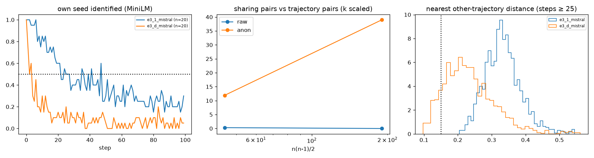

# E3-S (100 seeds) and E3-W (20-word summary): Haiku compress–expand

Predictions: predictions.md "E3 scale and bottleneck width" (2026-11-02). Pair-sharing rule and k scaling as stated there; anonymised = names → X (E3-A filter).

**Speculation 1 (numerous wells): in between: sharing pairs present but no well reused by >= 4 (W > 500 at this n).** S1_wells_numerous fails; S2_replication_first20 fails; S3_density fails; S4_seed_trace fails

## Cells

| cell | n | half-life | own seed 10 / 50 / 99 | nn-other raw / anon | within 0.15 raw / anon | Vendi story / summary at 99 | words at 99 | summary words (≤20 / ≤50) | top-10 cover | top names 50–99 | modal tuple (share) | woman / hopeful |
|---|---|---|---|---|---|---|---|---|---|---|---|---|
| e3_1_mistral | 20 | 22 | 0.85 / 0.3 / 0.3 | 0.330 / 0.220 | 0.000 / 0.019 | 9.1 / 12.2 | 388 | 58.0 (0.00 / 0.24) | 0.50 | Meadowgrove 68, Amelia 67, Mia 56, Aurora 50, Eldoria 46 | unclear × social_or_community × hopeful (0.33) | 0.34 / 0.88 |
| e3_d_mistral | 20 | 2 | 0.3 / 0.05 / 0.05 | 0.223 / 0.171 | 0.111 / 0.361 | 7.3 / 5.5 | 419 | 24.0 (0.40 / 0.99) | 0.37 | Meadowgrove 76, Elara 49, Elderglen 46, Harmonyville 44, Harmonia 31 | unclear × social_or_community × hopeful (0.42) | 0.47 / 0.98 |

## E3-S: pair sharing at n = 20 (k 40)

| atlas | persistent | shared (≥ 2 traj) | sharing pairs / pairs | rate | max trajectories in one cluster | W-hat | steps inside |
|---|---|---|---|---|---|---|---|
| raw | 0 | 0 | 0 / 190 | 0.0000 | 0 | None | 0.00 |
| anon | 8 | 8 | 39 / 190 | 0.2053 | 6 | 5 | 0.29 |

Random 20-trajectory subsamples (50, k 40): shared clusters median raw 0 (IQR [0.0, 0.0]), anon 8 (IQR [8.0, 8.0]); mean sharing pairs raw 0.00, anon 39.00; largest multiplicity raw 0, anon 6. The 20-trajectory cell e3_1_haiku had 0 shared (raw).

Sharing pairs vs n (mean over 10 draws, k scaled): n 10: raw 0.3, anon 11.9 of 45; n 20: raw 0.0, anon 39.0 of 190. A fixed well count gives pairs ∝ n(n−1)/2.

Fresh sample of seeds 0–19: half-life 2 (20-trajectory subsample median over all 100: 2, IQR [2.0, 2.0]); nn-other 0.223; words 419; top-10 cover 0.37, top names Meadowgrove 76, Elara 49, Elderglen 46, Harmonyville 44, Harmonia 31; modal tuple unclear × social_or_community × hopeful (0.42).

Same-seed check (base vs scale, seeds 0–19, steps 50–99, median nearest-step distance): same-seed 0.428 vs different-seed 0.402 (gap -0.026; anonymised gap -0.025); 0 of 20 same-seed pairs share a persistent cluster in the joint atlas (k 79, 0 shared clusters, 0 sharing pairs).

Shared-cluster sheets: `sw_cluster_e3_d_mistral_raw.md`, `sw_cluster_e3_d_mistral_anon.md`.

## Verdicts

- **S1_wells_numerous**: {"anon_sharing_pairs": 39, "anon_rate": 0.20526315789473684, "anon_shared_clusters": 8, "anon_max_mult": 6, "raw_shared_clusters": 0, "raw_sharing_pairs": 0, "W_hat_anon": 4.871794871794871, "sub_raw_shared_median": 0.0, "sub_anon_shared_median": 8.0, "holds": false, "fails": false}
- **S2_replication_first20**: {"half_life": 2, "half_in_8_15": false, "cover": 0.3675392670157068, "cover_in_band": false, "top_name": "Meadowgrove", "maya_top": false, "words": 419.0, "words_in_band": false, "modal": ["unclear", "social_or_community", "hopeful"], "base_modal": ["unclear", "social_or_community", "hopeful"], "modal_same": true, "all100": {"half_life_sub_median": 2.0, "cover": 0.3675392670157068, "words": 419.0}, "holds": false}
- **S3_density**: {"nn_other": 0.22300262075962518, "base_nn": 0.3303112351896903, "nn_in_band": false, "within_015": 0.11133333333333334, "within_in_band": false, "holds": false, "continuum": false}
- **S4_seed_trace**: {"gap_raw": -0.02647283183081489, "gap_anon": -0.025004816687937137, "gap_in_band": false, "same_seed_pairs_sharing": 0, "le_1": true, "holds": false}
- **speculation_1**: in between: sharing pairs present but no well reused by >= 4 (W > 500 at this n)

