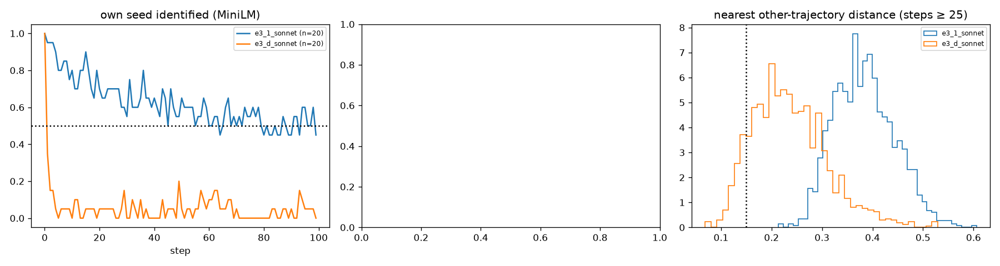

# E3-S (100 seeds) and E3-W (20-word summary): Haiku compress–expand

Predictions: predictions.md "E3 scale and bottleneck width" (2026-11-02). Pair-sharing rule and k scaling as stated there; anonymised = names → X (E3-A filter).

**D1 (abstraction converges): fails, 2 of 4 clauses** (shared raw 0 vs ≥ 2; half-life 1 vs ≤ 10; nn-other 0.227 vs ≤ 0.30; theme Vendi 7.5 vs ≤ half of 14.0).

## Cells

| cell | n | half-life | own seed 10 / 50 / 99 | nn-other raw / anon | within 0.15 raw / anon | Vendi story / summary at 99 | words at 99 | summary words (≤20 / ≤50) | top-10 cover | top names 50–99 | modal tuple (share) | woman / hopeful |
|---|---|---|---|---|---|---|---|---|---|---|---|---|
| e3_1_sonnet | 20 | 45 | 0.8 / 0.65 / 0.45 | 0.381 / 0.293 | 0.000 / 0.000 | 10.3 / 14.0 | 558 | 48.0 (0.00 / 0.86) | 0.40 | Mara 87, Pip 43, Dev 40, Priya 39, Marisol 37 | young_adult × interpersonal × hopeful (0.07) | 0.62 / 0.61 |
| e3_d_sonnet | 20 | 1 | 0.0 / 0.05 / 0.0 | 0.227 / 0.192 | 0.105 / 0.219 | 7.0 / 7.5 | 542 | 22.0 (0.30 / 1.00) | 0.57 | Marta 148, Marguerite 98, Daniel 78, Walter 76, Dev 36 | older_adult × internal × hopeful (0.15) | 0.82 / 0.72 |

## E3-W: joint atlas with e3_1_sonnet (k 40)

| atlas | width persistent (shared, pairs) | base persistent (shared, pairs) | clusters visited by both cells |
|---|---|---|---|
| raw | 0 (0, 0) | 14 (0, 0) | 0 |
| anon | 4 (4, 42) | 14 (0, 0) | 1 |

Shared-cluster sheets: `sw_cluster_e3_d_sonnet_raw.md`, `sw_cluster_e3_d_sonnet_anon.md`.

## Verdicts

- **D1_abstraction_converges**: {"shared_raw": 0, "shared_anon": 4, "need_shared": 2, "shared_ok": false, "base_shared_raw": 0, "half_life": 1, "base_half": 45, "half_le_10": true, "nn_other": 0.22712790198591565, "base_nn": 0.38108370731356606, "nn_le_030": true, "within_015": 0.10533333333333333, "vendi_theme_99": 7.529674889296712, "base_vendi_summary_99": 13.98091372472212, "vendi_half": false, "cover": 0.571715145436309, "base_cover": 0.4024144869215292, "words": 542.5, "theme_words_median": 22.0, "theme_le25": 0.941, "n_clauses_hold": 2, "holds": false}
- **D_theme_layer_posthoc**: {"modal": ["older_adult", "internal", "hopeful"], "base_modal": ["young_adult", "interpersonal", "hopeful"], "modal_share": 0.154, "base_modal_share": 0.0712136409227683, "woman": 0.82, "base_woman": 0.6178535606820461, "hopeful": 0.722, "base_hopeful": 0.6148445336008024}

