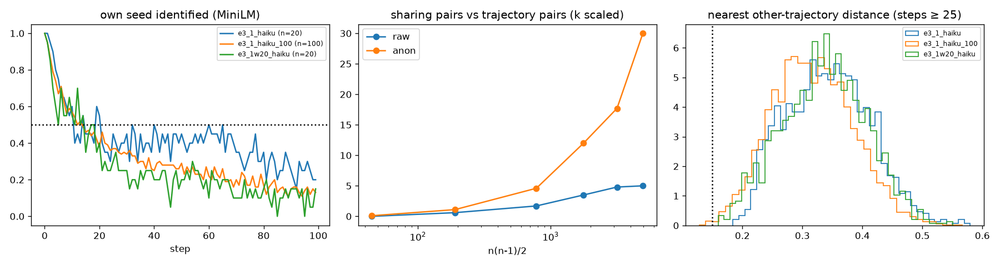

# E3-S (100 seeds) and E3-W (20-word summary): Haiku compress–expand

Predictions: predictions.md "E3 scale and bottleneck width" (2026-11-02). Pair-sharing rule and k scaling as stated there; anonymised = names → X (E3-A filter).

**Speculation 1 (numerous wells): holds.** S1_wells_numerous holds; S2_replication_first20 fails; S3_density fails; S4_seed_trace holds

**Speculation 2 (width): W1 3 of 8 clauses; W1_width_is_a_lever fails; W2_compliance fails; W4_same_destination fails.**

## Cells

| cell | n | half-life | own seed 10 / 50 / 99 | nn-other raw / anon | within 0.15 raw / anon | Vendi story / summary at 99 | words at 99 | summary words (≤20 / ≤50) | top-10 cover | top names 50–99 | modal tuple (share) | woman / hopeful |
|---|---|---|---|---|---|---|---|---|---|---|---|---|
| e3_1_haiku | 20 | 11 | 0.6 / 0.45 / 0.2 | 0.342 / 0.262 | 0.000 / 0.004 | 9.5 / 13.1 | 502 | 50.0 (0.00 / 0.55) | 0.54 | Maya 200, Nora 55, Daniel 52, Priya 43, Mara 39 | young_adult × internal × hopeful (0.16) | 0.70 / 0.73 |
| e3_1_haiku_100 | 100 | 12 | 0.57 / 0.29 / 0.13 | 0.314 / 0.243 | 0.002 / 0.013 | 21.6 / 37.9 | 512 | 48.0 (0.00 / 0.64) | 0.39 | Maya 412, Ruth 362, Mara 190, Tomas 178, Marcus 151 | young_adult × internal × hopeful (0.09) | 0.67 / 0.70 |
| e3_1w20_haiku | 20 | 5 | 0.55 / 0.2 / 0.15 | 0.338 / 0.266 | 0.000 / 0.004 | 9.6 / 14.6 | 488 | 20.0 (0.64 / 1.00) | 0.44 | Nora 77, Walt 57, Maya 48, Walter 48, Gerald 46 | unclear × social_or_community × hopeful (0.11) | 0.70 / 0.73 |

## E3-S: pair sharing at n = 100 (k 198)

| atlas | persistent | shared (≥ 2 traj) | sharing pairs / pairs | rate | max trajectories in one cluster | W-hat | steps inside |
|---|---|---|---|---|---|---|---|
| raw | 54 | 5 | 5 / 4950 | 0.0010 | 2 | 990 | 0.25 |
| anon | 46 | 13 | 30 / 4950 | 0.0061 | 4 | 165 | 0.24 |

Random 20-trajectory subsamples (50, k 40): shared clusters median raw 0 (IQR [0.0, 0.75]), anon 1 (IQR [0.25, 1.0]); mean sharing pairs raw 0.34, anon 1.38; largest multiplicity raw 3, anon 4. The 20-trajectory cell e3_1_haiku had 0 shared (raw).

Sharing pairs vs n (mean over 10 draws, k scaled): n 10: raw 0.0, anon 0.1 of 45; n 20: raw 0.6, anon 1.1 of 190; n 40: raw 1.7, anon 4.6 of 780; n 60: raw 3.5, anon 12.0 of 1770; n 80: raw 4.8, anon 17.7 of 3160; n 100: raw 5.0, anon 30.0 of 4950. A fixed well count gives pairs ∝ n(n−1)/2.

Fresh sample of seeds 0–19: half-life 18 (20-trajectory subsample median over all 100: 26, IQR [17.0, 30.0]); nn-other 0.356; words 494; top-10 cover 0.47, top names Maya 89, Mara 65, Eli 49, Jenna 47, Tomas 42; modal tuple young_adult × interpersonal × hopeful (0.10).

Same-seed check (base vs scale, seeds 0–19, steps 50–99, median nearest-step distance): same-seed 0.426 vs different-seed 0.492 (gap 0.065; anonymised gap 0.028); 1 of 20 same-seed pairs share a persistent cluster in the joint atlas (k 238, 9 shared clusters, 9 sharing pairs).

Shared-cluster sheets: `sw_cluster_e3_1_haiku_100_raw.md`, `sw_cluster_e3_1_haiku_100_anon.md`.

## E3-W: joint atlas with e3_1_haiku (k 40)

| atlas | width persistent (shared, pairs) | base persistent (shared, pairs) | clusters visited by both cells |
|---|---|---|---|
| raw | 8 (0, 0) | 12 (0, 0) | 5 |
| anon | 17 (2, 2) | 17 (1, 1) | 7 |

Shared-cluster sheets: `sw_cluster_e3_1w20_haiku_raw.md`, `sw_cluster_e3_1w20_haiku_anon.md`.

## Verdicts

- **S1_wells_numerous**: {"anon_sharing_pairs": 30, "anon_rate": 0.006060606060606061, "anon_shared_clusters": 13, "anon_max_mult": 4, "raw_shared_clusters": 5, "raw_sharing_pairs": 5, "W_hat_anon": 165.0, "sub_raw_shared_median": 0.0, "sub_anon_shared_median": 1.0, "holds": true, "fails": false}
- **S2_replication_first20**: {"half_life": 18, "half_in_8_15": false, "cover": 0.4651866801210898, "cover_in_band": true, "top_name": "Maya", "maya_top": true, "words": 494.5, "words_in_band": true, "modal": ["young_adult", "interpersonal", "hopeful"], "base_modal": ["young_adult", "internal", "hopeful"], "modal_same": false, "all100": {"half_life_sub_median": 25.5, "cover": 0.38548387096774195, "words": 511.5}, "holds": false}
- **S3_density**: {"nn_other": 0.3143040863573261, "base_nn": 0.34229522727353434, "nn_in_band": true, "within_015": 0.0018666666666666666, "within_in_band": false, "holds": false, "continuum": false}
- **S4_seed_trace**: {"gap_raw": 0.06530865919653345, "gap_anon": 0.028178676330149532, "gap_in_band": true, "same_seed_pairs_sharing": 1, "le_1": true, "holds": true}
- **speculation_1**: holds
- **W1_width_is_a_lever**: {"half_life": 5, "base_half": 11, "half_le_7": true, "nn_other": 0.3376811462704007, "base_nn": 0.34229522727353434, "nn_le_030": false, "within_015": 0.0, "within_ge_002": false, "shared_raw": 0, "shared_anon": 2, "base_shared_raw": 0, "cover": 0.4426559356136821, "cover_ge_060": false, "vendi_summary_99": 14.598626118246726, "base_vendi_summary_99": 13.120986175822729, "words": 487.5, "words_in_band": true, "n_clauses_hold": 3, "holds": false, "direction_if_wrong": false}
- **W2_compliance**: {"summary_median": 20.0, "median_in_20_28": true, "le20_share": 0.6385, "le20_in_band": false, "base_le50": 0.55, "empty_or_refusal": 0, "holds": false}
- **W3_trend**: {"half_20": 5, "half_50": 11, "nn_20": 0.3376811462704007, "nn_50": 0.34229522727353434, "monotone_so_far": true, "shared_raw": 0, "below_D1": true, "note": "30-word cell held; D not run"}
- **W4_same_destination**: {"modal": ["unclear", "social_or_community", "hopeful"], "base_modal": ["young_adult", "internal", "hopeful"], "modal_same": false, "modal_share": 0.109, "base_modal_share": 0.164, "share_up_005": false, "woman": 0.698, "base_woman": 0.696, "hopeful": 0.733, "base_hopeful": 0.733, "within_005": true, "holds": false}

