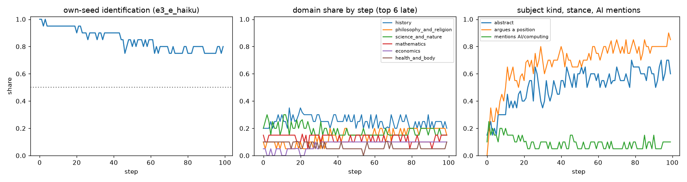

# E3-E gate: essay-loop pilot on Haiku (2026-11-03)

**Verdict: E4 holds; E1, E2 and E3 fail as written, E2 upward.** The essay loop is a different instrument from the story loop. Twenty
trajectories × 100 steps of essay → 50-word summary → essay keep their seed subject for the whole run (own-seed identification 0.80 at
step 99; the story loop's half-life was 11), form no shared wells, and converge instead in *stance*: by step 99, 85% of essays argue a
position (0% at step 0) and 60% are about an abstract theme (15% at step 0), while the domain mix stays as spread as the seeds. Per the
prediction's decision rule, E3 failing means the essay loop as run is a seed-memory test, and the bias arm needs a loop that abstracts
(a one-sentence thesis bottleneck, D-style) rather than one that summarises.

Predictions: `predictions.md` "E3-E essay-loop pilot (2026-11-03)". Run `e3_e_haiku` (claude-haiku-5-5, default sampling, effort low,
seeds 0–19 of `data/essay_seeds/vital3_100.pkl`, 8 concurrent, launched 11:42 PST, finished 12:27, 1.3 s per trajectory-step, $1.39).
Judge `analysis/essay_judge.py` (Haiku, schema fixed after the smoke essays and before any count; 1,997 of 2,000 coded, 3 malformed,
$0.54; archive `reports/e3/judge/e3_e_haiku.essay_judge.jsonl.gz`). Report `analysis/e3e_report.py` → `reports/e3/essay.{md,json,png}`,
sheets `reports/e3/sw_cluster_e3_e_haiku_{raw,anon}.md`.

| clause | predicted | measured | verdict |
|---|---|---|---|
| E1 raw shared wells | 0–2 | 0 (2 persistent clusters, each one trajectory) | holds |
| E1 anonymised shared wells / rate | 0–3 / ≤ 0.02 | 0 / 0.000 (0 of 190 pairs) | holds |
| E1 nn-other (late steps, nearest other trajectory) | 0.30–0.45 | **0.562** (anon 0.509) | fails: essays sit further apart than stories (Haiku story cell 0.342) |
| E1 within 0.15 of another trajectory | ≤ 0.01 | 0.000 | holds |
| E1 fails-upward clause (rate ≥ 0.05 or ≥ 4 raw wells) | not fired | not fired | — |
| E2 seed half-life | 15–40 | **none: identification never falls to 0.5** (0.95 at 10, 0.90 at 25, 0.80 at 50, 0.80 at 99) | fails upward |
| E2 own-seed identification at 50 | ≥ 0.5 | 0.80 | holds |
| E3 step-0 top domain | ≤ 0.20 | 0.20 (history, science tie) | holds |
| E3 late modal domain share (steps 50–99) | ≥ 0.35 | **0.24** (history) | fails; no-menu clause (< 0.25) fires |
| E3 abstract share, step 0 → late | ≤ 0.3 → ≥ 0.6 | 0.15 → 0.59 | holds within rounding (0.60 at step 99) |
| E3 named direction: modal domain society/politics or philosophy/religion | — | history 0.24, philosophy/religion 0.17, society/politics 0.03 | wrong |
| E4 median words at step 99 | 400–600 | 517 | holds |
| E4 summaries within 50 words | ≥ 0.5 | 0.79 (median 46) | holds |
| E4 refusals | 0 | 0 | holds |

## What the essays do

**They keep their subject.** Eighteen of twenty trajectories are still about their seed's subject at step 99 (the Columbian Exchange, hybrid
aircraft certification, algebra anxiety, the rise of allergies, the Nile and Egyptian continuity, Athenian democracy, anger, meat pricing,
the Hindu-Arabic numerals, mathematics invented or discovered, scientific anomalies, beauty, Bible reading, the Amazon's oxygen, bronze,
resilience regulation, writing instruction, Canadian history, molecular rearrangement, love). Two drifted to a neighbouring theme (the Bronze
Age seed → systemic resilience and outcome-based regulation; the cat seed → the nature of lasting love, by way of the cat's attachment).
The 50-word summary of an essay keeps its topic noun; the 50-word summary of a story loses its plot particulars. This is the mechanism
Brad named in E2, stronger than predicted.

**They converge in form, not in subject.** The judge's stance field moves from descriptive 1.00 at step 0 to argues-a-position 0.85 at step 99
(0.50 by step 10). Tone moves from celebratory/neutral (0.40/0.35 at step 0) to hopeful 0.55 at step 99. The step-99 summaries share a
template: "X is not Y but Z", three or four named pillars, and a closing prescription ("Honest teaching must…", "Regulators should…",
"Better is outcome-based regulation"). The recurrent moves are debunking a textbook framing, honest reckoning with past injustice, and
"balance" between two poles. Mentions of AI or computing stay at 0.07–0.10 throughout; environment or climate at 0.24 late (from the
Amazon, meat and allergy trajectories).

**No wells at n = 20**, as for the story cells; but unlike the story cells the trajectories also do not approach each other (nn-other 0.56
against the Haiku story cell's 0.34), so a 100-seed essay cell is not predicted to produce wells by the birthday arithmetic at the story rate. E5 ("for the
record") was conditional on E1 holding; E1 failed on the distance clause, so E5 lapses.

## Cell table (same measures as the story cells)

| cell | half-life | own seed 10 / 50 / 99 | nn-other raw / anon | within 0.15 | Vendi story / summary 99 | words 99 | summary ≤ 50 |
|---|---|---|---|---|---|---|---|
| e3_e_haiku (essay) | none | 0.95 / 0.80 / 0.80 | 0.562 / 0.509 | 0.000 | 16.2 / 17.2 | 517 | 0.79 |
| e3_1_haiku (story, 20 seeds) | 11 | 0.60 / 0.45 / 0.20 | 0.342 / 0.262 | 0.000 | 9.5 / 13.1 | 502 | 0.55 |

## Reading and what it changes

1. The essay loop measures **what Haiku does to an expository text under repeated summarise-and-rewrite**: it turns description into
   argument and a concrete subject into an abstract one while keeping the subject. That is a bias instrument of a different kind from the
   story loop: it shows the model's default *rhetorical posture* (argue, balance, prescribe, end hopeful) rather than its default plots.
2. For the bias arm Brad wants (contested topics such as AI data centres; does a seeded position survive?), the pilot says the 50-word
   summary bottleneck is too faithful: the position would survive because everything survives. The abstracting bottleneck (one-sentence
   thesis, D-style) is the design to test, with the position field of the essay judge as the measure.
3. A 100-seed essay cell at 50 words is not queued: no wells are expected at this distance. If Brad wants the domain-drift question answered
   with more seeds, the cheaper test is the thesis bottleneck at 20 seeds first (≈ $1.3).

Deviations: none from the config. Crash/resume: none (one InternalServerError and three APIConnectionError retries, all recovered).
