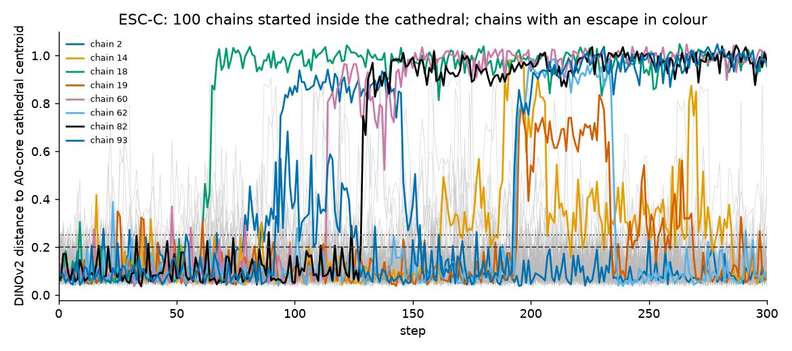
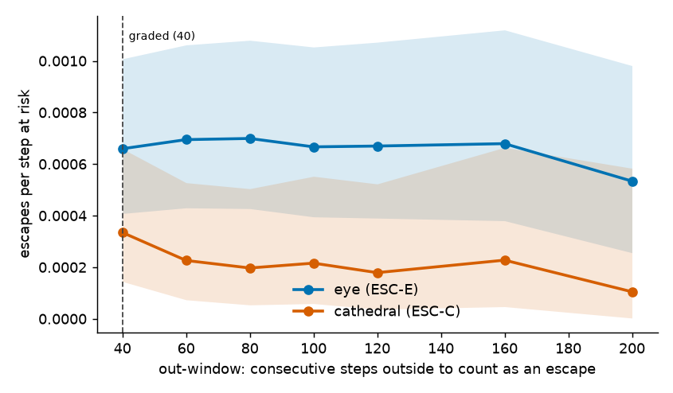
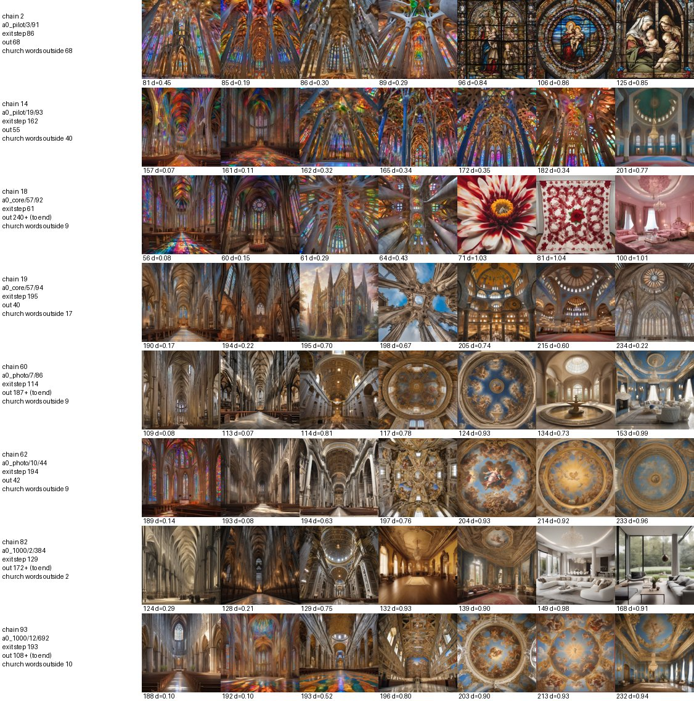

# ESC-C gate: escape from the SDXL + LLaVA cathedral

Brad Hinkel, with Claude (Anthropic). First draft by Claude (Opus 5.5), 2026-11-19. Predictions: `predictions.md` "ESC" (approved 2026-11-15, before the run). Script: `analysis/esc_c_report.py`; metrics: `reports/esc_c_metrics.json`. DINOv2 only; CLIP is not used.

## Verdict

| Prediction | Result | Verdict |
|---|---|---|
| **ESC-1** (Brad), cathedral half: at least one escape | **8 escapes** in 100 chains (4 never returned) | **PASS** |
| **ESC-2** (Brad), cathedral half: rate below 10⁻³ per step | **3.3 × 10⁻⁴** per step (95 % 1.4–6.6 × 10⁻⁴) | **PASS** |
| **ESC-4** (Claude): the cathedral's rate is below the eye's | 3.3 × 10⁻⁴ vs 6.6 × 10⁻⁴: lower, but the 95 % intervals overlap (cathedral up to 6.6, eye from 4.1 × 10⁻⁴) | **not resolved** |
| ESC-1 and ESC-2 overall (with ESC-E, reports/esc_e.md) | both large attractors can be escaped, each at under 10⁻³ per step | **PASS** |

The A0-1000 pilot's "one-way door" for the cathedral is wrong at this depth. In 23,921 steps at risk, 4 chains left the cathedral and never came back, ending 0.95–1.0 from its centroid. Another 4 were out for 40–68 steps and then returned.

The cathedral is stickier than the eye in every way measured: a lower escape rate, more time inside, and fewer permanent escapes. The graded test can't separate the two at 100 chains.

## Run

- **Chains:** 100 chains of SDXL + llava:latest (A0 exactly: SDXL base, 25 steps, 1024 → 512; llava 8dd30f6b0cb1; Hintze's verbatim instruction; T 0.9).
- **Start states:** each chain starts from a cathedral state of one of the 43 distinct SDXL + LLaVA entrants (`analysis/esc_c_states.py`). It is copied byte-identical as step 0.
- **Seeds:** steps 1–300 use sdxl_seed = 20261115 + chain × 10000 + step (D20 amendment).
- **Starting distances:** all 100 step-0 states are within 0.25 of the cathedral centroid (7 lie between 0.20 and 0.25, inside by hysteresis).
- **Pod:** lhyj9s7ex775et, secure RTX A6000, EU-SE-1, $0.69/h, with a 100 GB MFS network volume. It ran from 23:41 UTC on 2026-11-15 to 19:57 on 2026-11-18.
  - Throughput: 6.6–6.8 s per chain-step, about 660 s per step for 100 chains (SDXL about 5.0 s, LLaVA about 1.6 s with 8 Ollama slots).
- **Crash and resume:**
  - The volume returned `OSError: [Errno 5]` at 03:01 UTC on 2026-11-16 and the runner died at 03:39 in step 19. Steps 0–18 were verified (3,800 records, no partial step 19), and the run resumed at 14:50 the same day.
  - The pod became unresponsive at 19:18 UTC on 2026-11-17 and the container restarted at 19:39. Step 172 was partial (296 of 300 files, all valid); the run resumed at 20:16 and the runner made the 4 missing captions.
  - A pod watchdog (`scripts/pod_watchdog.sh`, boot hook `/pre_start.sh`) was installed after the second stop. It never had to act.
  - Crash logs are in logs/runpod/ (`esc_c.crash_20261116_eio.out`, `esc_c.restart_20261117_container.out`).
- **Final pull:** identical to the pod (90,305 files, name and size), with 0 empty captions.
- **Cost:** the pod billed about 101 h (≈ $70) for ESC-C and T1's 30,000 captions together. About 33 h (≈ $23) of that was idle: 11 h after the volume error, 1 h after the container restart, and 21 h after T1 finished.

## Numbers

| | cathedral (ESC-C) | eye (ESC-E) |
|---|---|---|
| Inside share, all chain-steps | 0.916 | 0.875 |
| Chains ever outside / inside at the last step | 100 / 90 | 90 / 80 |
| Exits (all) / exits that returned | 721 / 711 | 227 / 207 |
| Longest returning exit | 68 steps | 88 steps |
| Steps at risk | 23,921 (steps 0–260) | 31,852 (steps 0–360) |
| Escapes (≥ 40 steps out) / of which returned | 8 / 4 | 21 / 3 |
| Rate (95 %) | 3.3 × 10⁻⁴ (1.4–6.6) | 6.6 × 10⁻⁴ (4.1–10.1) |
| Chain-steps more than 0.35 / 0.6 from the centroid | 1,444 / 986 | n/a |
| Captions without church words (of 30,100) | 765 | n/a |

Every chain left the cathedral at some point. The cathedral exits often (721 times) but almost always comes straight back. Half of its 40-step "escapes" returned too, against 3 of 21 for the eye.

## Out-window sensitivity (the ESC-E lesson; not graded)

ESC-E showed that 40 steps out does not mean gone for good. Both runs were therefore recounted with longer out-windows, each with its own steps at risk.

| out-window (steps) | 40 | 60 | 80 | 100 | 120 | 160 | 200 |
|---|---|---|---|---|---|---|---|
| eye escapes | 21 | 21 | 20 | 18 | 17 | 15 | 10 |
| cathedral escapes | 8 | 5 | 4 | 4 | 3 | 3 | 1 |
| eye ÷ cathedral rate | 2.0 | 3.1 | 3.6 | 3.1 | 3.7 | 3.0 | 5.1 |
| one-sided p, eye > cathedral (post-hoc) | 0.068 | 0.012 | 0.009 | 0.023 | 0.017 | 0.052 | 0.071 |

- The eye's rate is flat at about 6.7 × 10⁻⁴ from 40 to 160 steps. Its escapes are real exits.
- The cathedral's rate falls from 3.3 to about 2 × 10⁻⁴ once returns of up to 68 steps are excluded. The 4 permanent escapes give **about 2 × 10⁻⁴ per step, roughly a third of the eye's rate**.
- A post-hoc comparison of the two rates (a binomial test on the share of escapes falling to the eye, given each run's steps at risk) favours "eye leakier" at every window. It is significant at 60–120 steps (p = 0.01–0.02), but not at the graded 40 (p = 0.07).
- ESC-4 stays "not resolved" as graded. The extra evidence points the way ESC-4 predicted.

## Routes out (descriptive, from the contact sheet; not a test)

*Each row shows one escape: steps exit−5, exit−1, exit, +3, +10, +20 and +39, with the DINOv2 distance to the cathedral centroid.*

**1. Landmark to fresco to palace room: 3 of the 4 permanent escapes, and 2 of the 4 that returned.**
- The caption names a specific famous church: St Peter's, then **the Sistine Chapel**. The picture moves up to a painted dome or ceiling fresco, at distance 0.8–0.95.
- The next captions describe "a grand ceiling" or "an opulent room" without church words. The chain ends in a palace hall, a bedroom or a modern living room (chains 60, 82, 93).
- No escape began from a caption that had already dropped the church: every exit's prompt caption names one. The church words drop out after the picture has left. The permanent escapes kept church words in only 2–10 of their 108–240 outside captions.
- This is the cathedral's version of the eye's focus shift. The words leave last.
- Chains 62 and 19 went the same way, as far as the dome or a Hagia-Sophia-like interior, and came back.

**2. Sudden reinterpretation: 1 of 4 (chain 18).**
- Sagrada Família's coloured glass is redrawn as a **flower**, then a quilt, then a pink bedroom. The distance jumps from 0.43 to 1.03 within 10 steps.
- This is the eye's iris-to-flower route on a different attractor.

**Returns that stayed in church vocabulary:** chains 2 and 14 (Sagrada Família, then a stained-glass Madonna or a domed hall) were out for 55–68 steps with church words in most or all of their captions, and came back.

## What this means for T1 (A0-ESC P1)

T1's 30,000 fresh LLaVA captions of post-entry cathedral images produced 168 churchless captions, from 25 distinct images, almost all from the far rim (136 of them more than 0.6 from the centroid). They describe the same places ESC-C's escapes went through: frescoed ceilings, grand halls, libraries, palace rooms.

The continuation stage (`runs/t1_cont`, 168 chains × 30 steps) is built and seeded (D20 amendment and implementation note, 2026-11-19). It runs on a pod once Brad gives the go.

## Deviations, crash and resume

- Deviations: D20 amendment 2026-11-15 (ESC-C seeded starts, base 20261115; 24 starts come from A0-photo with photo-instruction step-0 captions). There were no new deviations.
- Crash and resume: as listed under Run. Both stops were infrastructure failures, and both resumes were verified before restarting. No step was redone and nothing was overwritten.
