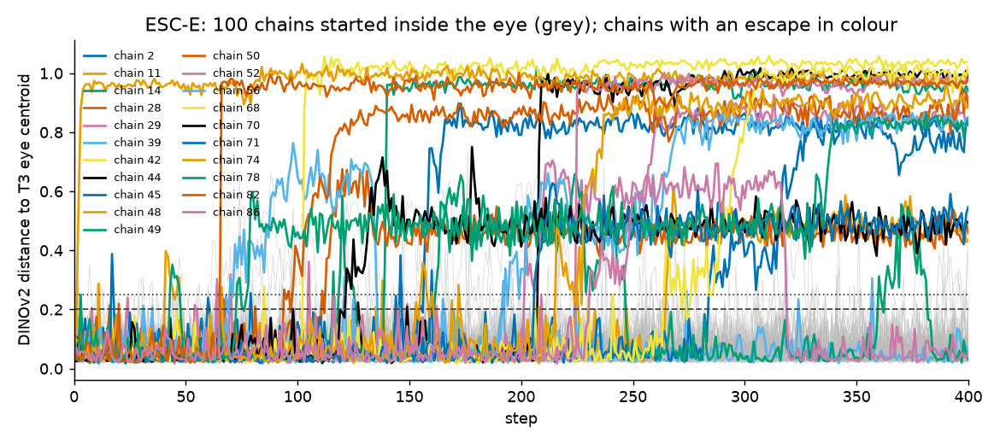
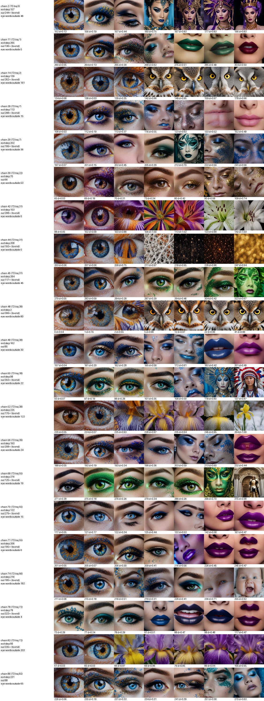

# ESC-E gate: escape from the fast pair's eye attractor

Brad Hinkel, with Claude (Anthropic). First draft by Claude (Opus 5.5), 2026-11-16. Predictions: `predictions.md` "ESC" (approved 2026-11-15, before the run). Script: `analysis/esc_e_report.py`; metrics: `reports/esc_e_metrics.json`. DINOv2 only; CLIP is not used.

## Verdict

| Prediction | Result | Verdict |
|---|---|---|
| **ESC-1** (Brad), eye half: at least one escape | **21 escapes** in 100 chains | **PASS** |
| **ESC-2** (Brad), eye half: rate below 10⁻³ per step | **6.6 × 10⁻⁴** per step (95 % 4.1–10.1 × 10⁻⁴) | **PASS** |
| ESC-2 (Claude's band): 10⁻⁴ to 10⁻³, and within ×3 of T3's 3.2 × 10⁻⁴ (1.07–9.6 × 10⁻⁴) | 6.6 × 10⁻⁴: inside both | **PASS** |
| **ESC-3** (Claude): ≥ 75 % focus shifts, ≤ 25 % start from a caption without eye words (≥ 4 escapes, so graded) | 19 of 21 focus shifts (90 %); 0 of 21 start without eye words | **PASS** |
| ESC-1 cathedral half, ESC-2 cathedral half, ESC-4 | need ESC-C (resumed, at step ~19 of 300) | pending |

The eye can be escaped, rarely: about 1 in 1,500 steps inside it. The rate replicates T3's in-run figure within a factor of about 2, even though T3 measured it with a stricter rule.

## Run

- **Chains:** 100 chains of the fast pair (SDXL-Turbo 1 step at 512 px, plus Moondream 2; the D21 pins as in T3). Each chain starts from a T3 eye state: 17 entrants, about 6 states each, chosen by `scripts/seed_states.py` with rng 20261115.
  - Every chain's step 0 is a byte-identical copy of the T3 state. All 100 are within 0.20 of the eye centroid.
  - Steps 1–400 are new, with sdxl_seed = 20261115 + chain × 10000 + step.
- **Pod:** 99mvek7zsgwckx, a secure RTX 4090 at $0.89/h, with a 100 GB local volume. It ran from 23:25 UTC on 2026-11-15 to 09:27 on 2026-11-16 (10.0 h).
  - Throughput: 0.9 s per chain-step (SDXL-Turbo 0.3 s, Moondream 0.6 s).
  - There were no crashes and 0 empty captions.
- **Pull and cost:** the final pull is identical to the pod (120,305 files, name and size). The pod was terminated about 15:00 UTC.
  - About 16 h were billed (≈ $14). Of that, about 5.5 h (≈ $5) was idle after the run finished, before it was noticed.
- **Embeddings:** analysis/cache/esc_e/{dinov2,minilm}.npz.

## Definitions (fixed before the run)

- **Inside:** DINOv2 cosine distance to T3's eye centroid (`reports/fast_1000_labels.npz` C[1], sha256 checked) of at most 0.20, with exit hysteresis 1.25. A chain starts inside.
- **Escape:** an exit followed by at least 40 consecutive steps outside.
- **Rate:** escapes divided by the inside steps 0–360. There are 31,852 such steps at risk.

## Numbers

| | |
|---|---|
| Inside share, all chain-steps | 0.875 |
| Exits (all) / exits that returned | 227 / 207 |
| Chains that ever left / chains inside at step 400 | 90 / 80 |
| Escapes (≥ 40 steps out) | 21, from 12 of the 17 T3 entrants (at most 4 from one) |
| Escapes that later returned | **3** (out 66, 85, 88 steps) |
| Longest returning exit | **88 steps** (6 returning exits lasted more than 28 steps) |
| Never returned, last inside step ≥ 100 before the end (T3's rule) | 18 chains |

## The 40-step rule was too short

The escape rule (40 steps = 1.4 × the longest returning exit seen in T3 or A0-1000, 28 steps) was set before the run. ESC-E shows that a chain can leave for up to 88 steps and still come back. Three of the 21 escapes are of that kind: chains 39, 49 and 86, which all went out by way of glitter makeup.

The verdicts above use the rule as written. A sensitivity check that counts only the 18 escapes that never came back gives **5.7 × 10⁻⁴** per step (95 % 3.3–8.9 × 10⁻⁴). ESC-1, ESC-2 and both of Claude's bands still pass.

For ESC-C and anything later, the lesson is that "escape" needs a longer out-window than the longest return seen so far. Better, it should be reported as a curve over the out-window, not a single cut. This is noted here, not applied to the graded numbers.

## Routes out (descriptive, hand-coded from the contact sheet; not a test)

*Each row shows one escape: steps exit−5, exit−1, exit, +3, +10, +20 and +39, with the DINOv2 distance to the eye centroid.*

There are two routes, and they look different in the distance trace.

**1. Makeup drift, slow: 15 of 21, including all 3 that returned.**
- The caption keeps the eye and adds one thing: glitter, eyeshadow or eyeliner. The picture widens to the made-up eye, then to the face.
- From the face the chains end up as:
  - **lips**, 7 chains (11, 28, 49 returned, 56, 70, 71, 78; 56 and 78 later move on again, ending 0.83–0.84 from the eye);
  - a face with paint, a headdress or a mask (2, 29, 45, 50, 74, and 68, which ends as a knight under a stone arch).
- This is exactly T3's eye-escape route (makeup, then face, then lips or headdress).
- The distance climbs over 5–20 steps, often pausing around 0.3–0.5.
- The lips state sits 0.44–0.50 from the eye centroid, on its own plateau (the band in the distance figure). It is **not** one of T3's attractors: the nearest T3 centroid is still the eye.
- So Brad's "eye or lips" close-up is two neighbouring wells, and the second is reached from the first.

**2. Reinterpretation, sudden: 6 of 21.**
- The generator draws the eye's radial iris pattern as something else, and the next caption names what it now sees:
  - an owl's face (14, 48; the caption says "owl's eye" and keeps the eye words);
  - an **iris flower** (52, 82);
  - a lily (42);
  - a lattice or texture of stones (44).
- The distance jumps from about 0.05 to 0.9 or more in one to three steps.
- The iris-flower chains go through the word "iris", which names the flower while the eye-word list counts it as an eye.

Only chain 68 ends inside any T3 attractor. The other 20 end in places T3's map doesn't name, the same as T3's own escapees, which were parked alone.

## ESC-3 caveats

- **"iris" is a pun.** Chains 52 and 82 count as focus shifts because their flower captions say "iris". With "iris" taken out of the eye-word list, chain 52 has no eye words outside the eye (82 still has enough). The count drops to **18 of 21 (86 %)**, still a pass.
- **The owl counts as a focus shift.** The owl chains count as focus shifts under the rule as written ("owl's eye"). They are really the generator's reinterpretation of the picture, not the caption's drift.
- **A tighter reading.** Counting only route 1 as a focus shift, the share is 15 of 21 (71 %), just under 75 %. ESC-3 passes as defined, but the second route is real and not small.
- **What holds without qualification:** no escape starts from a caption that has dropped the eye. Every exit's prompt caption still named the eye.

## Deviations, crash and resume

- Deviations: D21 amendment (ESC-E: seeded starts, base seed 20261115). There were no new deviations.
- No crash and no resume on this run.
- ESC-C, the cathedral half, crashed on a network-volume I/O error at step 19. It was checked and resumed on 2026-11-16 (STATUS.md). Its grade, ESC-4, follows when it finishes, at about 2026-11-18 21:00 UTC.
