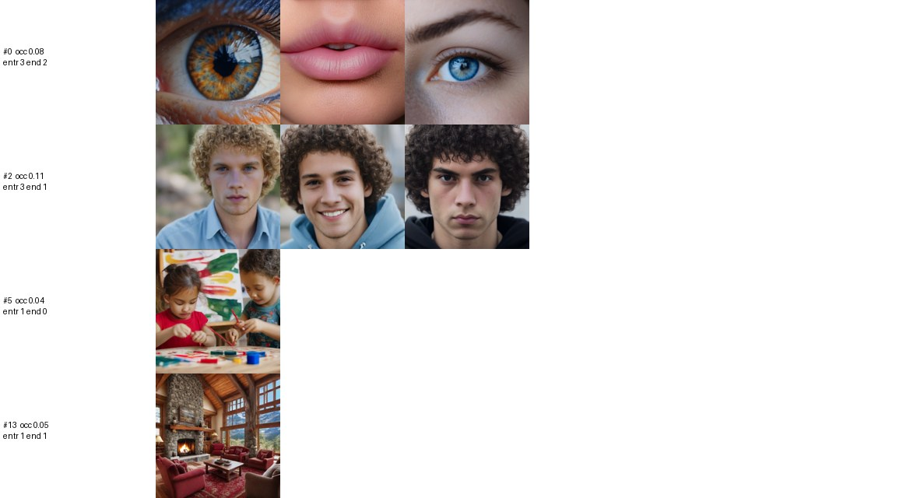
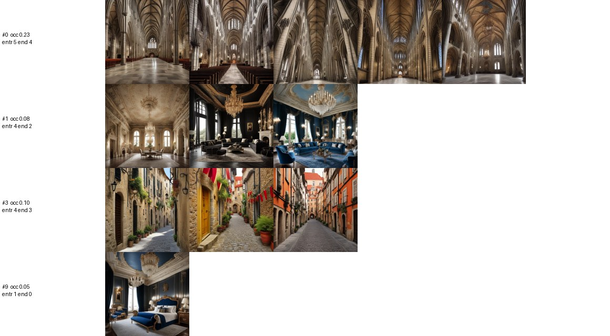

# FAST-100 pilot and FAST-X crossed cell (20 trajectories × 100 steps each, laptop, 2026-11-12)

**Runs: PASS** (both finished clean, 0 empty captions, no crash or restart).
**Prediction: F1 FAIL (1 of 3 parts), F2 PASS, F3 FAIL (holding clause).**

**The captioner sets the attractors.** With LLaVA as the captioner, SDXL-Turbo rebuilds A0's map almost exactly (cathedral 21 % of steps 50–99 against A0's 20 %; total-variation distance 0.10). With Moondream 2 the map is gone (1.9 % of steps inside any A0 attractor; distance 0.39). Moondream's own attractors are close-ups of human features.

Prediction: predictions.md "FAST-100" (2026-11-12, Brad's, bands by Claude), written and committed (3fc879c) before either run. Departures: DEVIATIONS.md D21. Graded with DINOv2 only (CLIP is not used). Rebuild: `analysis/embed.py <run> --spaces dinov2,minilm` for both runs, then `analysis/fast_report.py --cross fast_x_llava` (→ `reports/fast_100_metrics.json`, `figures/fast_100_attractors.jpg`, `figures/fast_x_llava_attractors.jpg`).

| cell | generator | captioner | run |
|---|---|---|---|
| A0-core (trajectories 0–19, reference) | SDXL base, 25 steps, 1024 → 512 | llava:latest | `runs/a0_core` |
| **FAST** | SDXL-Turbo, 1 step, 512 | Moondream 2 (2025-06-21) | `runs/fast_100` |
| **FAST-X** | SDXL-Turbo, 1 step, 512 | llava:latest | `runs/fast_x_llava` |

Same seeds (Hintze 0–19), instruction (verbatim), temperature 0.9 and seed formula in all three.

## Predictions graded

| | prediction | measured | verdict |
|---|---|---|---|
| **F1** different set, some overlap | ≥ 1 persistent FAST attractor within 0.20 of an A0-core centroid | none. Trajectory 10 sits in a gothic nave 0.17 from A0's cathedral from step ~40, but alone, so it is one visit, not the ≥ 3 the persistence rule needs | FAIL |
| | ≥ 1 persistent FAST attractor > 0.35 from every A0-core centroid | the close-up (eye or lips, 0.94) and the curly-haired young man (0.92) | pass |
| | share of FAST steps 50–99 inside any A0 attractor in 5–60 % | **1.9 %** (A0-core 0–19: 41 %) | FAIL |
| **F2** captioner dominates | TV distance to A0-core occupancy (8 A0 attractors + outside, steps 50–99): FAST-X < FAST | **FAST-X 0.10, FAST 0.39** | **PASS** |
| **F3** nothing as strong as the cathedral | no persistent FAST attractor entered by ≥ 3 trajectories holds all of them | the close-up holds 3 of 3 (entries at steps 31, 38, 79) | FAIL |
| | no FAST attractor holds > 30 % of step-99 endpoints | largest 2 of 20 (10 %) | pass |

F3 was flagged in the prediction as a weak test at 100 steps (A0's cathedral also held every entrant in its first 100 steps). The 1,000-step run (A0-ESC T3) is the real test.

## Occupancy of A0's attractors, steps 50–99

| | cathedral | palatial salon | canopy bedroom | Victorian house | outside all |
|---|---|---|---|---|---|
| A0-core 0–19 | 0.196 | 0.143 | 0.065 | 0.007 | 0.589 |
| FAST-X (Turbo + LLaVA) | **0.213** | 0.067 | 0.039 | 0.007 | 0.674 |
| FAST (Turbo + Moondream) | 0.019 | 0 | 0 | 0 | 0.981 |

Step-99 endpoints in A0 attractors: FAST-X 4 cathedral + 2 salon of 20; FAST 1 cathedral.

## FAST's own map

The elbow on steps 50–99 gives k = 16, and 12 of the 16 clusters are a single trajectory parked in its own scene (daisies, porcelain vases, monks in a red-lantern street, zebras at a pink sunset, a Christ statue, an antique book …). Four are persistent:

| FAST attractor | entrants | holds | step-99 endpoints | occupancy 50–99 |
|---|---|---|---|---|
| extreme close-up: eye or lips | 3 (2, 12, 19) | 3 of 3 | 2 | 0.084 |
| close-up portrait, curly-haired young man | 3 (0, 1, 19) | 2 of 3 (19 left for the eye) | 1 | 0.108 |
| children at a craft table | 1 | 1 | 0 | 0.036 |
| rustic lodge living room | 1 | 1 | 1 | 0.046 |

The loop zooms in. Trajectory 19 went from the curly-haired portrait to an extreme close-up of an eye, the only move between FAST attractors. Moondream writes short literal captions (median 28 words; 28 of 2,000 over 50) that name the subject, and SDXL-Turbo frames it closer each time. Style words do not survive: painted seeds become photographs within 1–2 steps.

FAST-X's own map (k = 10) is A0's: a cathedral (0.08 from A0's centroid, 5 entrants), the gold-and-blue salon (0.05, 4 entrants), the canopy bedroom (0.04), and an old-town street (0.44 from A0's loose village centroid, 4 of 4 held). LLaVA's captions run as long as in A0 (median 117 words; 1,988 of 2,000 over 50).

## A cathedral departure with LLaVA (first observed)

In FAST-X, trajectory 19 entered the cathedral at step 61 and left at step 93: nave (61–90) → "the Notre Dame Cathedral in Paris … from a high vantage point" (91–92, an aerial exterior) → "a quaint European street scene" (93) → "an old European alleyway" (99), inside FAST-X's old-town attractor. It counts as a departure under the A0-1000 rule (it visits another attractor after entry); it has only 7 steps outside before the run ends, so it may yet return. No departure was seen in 63 earlier LLaVA entrants (SDXL or Hunyuan). The route is the one the A0-1000 excursions took (a Notre-Dame exterior), which there always returned. The other 4 FAST-X entrants stayed (0 churchless captions in 72–92 post-entry steps each).

## Run health and throughput

| | FAST | FAST-X |
|---|---|---|
| steps | 2,000 (20 × 100) | 2,000 |
| wall time | 55 min (11:51–12:46) | 2 h 22 min (12:46–15:08) |
| steady rate | **1.5–1.6 s per trajectory-step** (image 0.6–0.7, caption 0.9) | 3.9–4.1 s (image 0.7, caption 3.1–3.4) |
| captions | 0 empty, 0 refusals; median 28 words | 0 empty; median 117 words |
| hardware | RTX 5070 laptop 8 GB, two-pass; peak 5.3 GB (SDXL-Turbo, CPU offload, batch 10), 3.9 GB (Moondream) | same; LLaVA via Ollama |

No crash, restart or retry. The Moondream setup and its two compatibility shims are in D21; the earlier smokes are `runs/fast_smoke` (Turbo + LLaVA, 4 × 5) and `runs/fast_md_smoke2` (Turbo + Moondream, 4 × 3).

## Next: the 100 × 1,000 run (A0-ESC T3)

Brad approved T3 on a secure RTX 4090 pod after these pilots. Its predictions (A0-ESC P2, P2b, P3's T3 clause) are still marked draft in predictions.md and need Brad's OK before it runs. Two things this pilot suggests for them:
- **The persistence rule needs ≥ 3 visits.** That rule ignores single trajectories parked for a long time (12 of FAST's 16 clusters are single trajectories). At 1,000 steps that may still be most of the map, so P2's "more than 90 % of trajectory-steps inside a persistent attractor" is likely to fail for that reason alone.
- **Run the FAST-X cell to 1,000 steps alongside it.** It is the only setting outside SDXL+LLaVA with a cathedral, and it has already produced the first departure. The cheapest way would be to run 20 FAST-X trajectories next to T3.

Rough cost on a secure RTX 4090 at the $0.89/h quoted on 2026-11-12 (to be re-read before creating the pod): T3 (100 × 1,000 FAST) at an estimated 0.3–0.5 s per trajectory-step with both models resident is ~8–14 h, ~$7–12; adding 20 × 1,000 FAST-X at ~1–1.5 s (LLaVA bound) is ~6–8 h more, ~$6.
