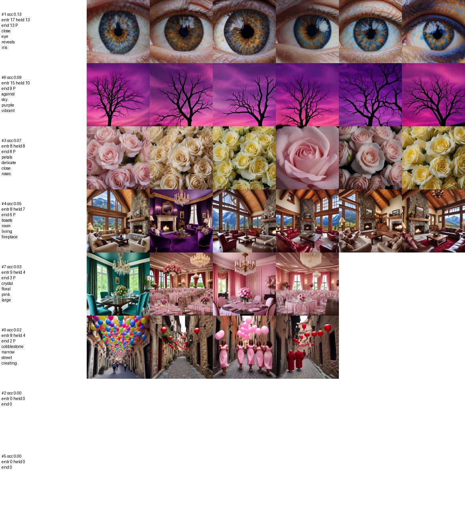
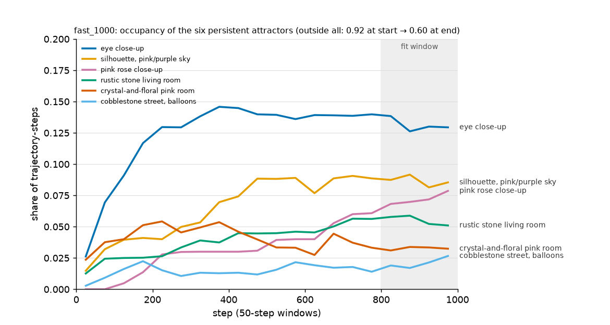

# A0-ESC T3: the fast pair at 1,000 steps (100 trajectories × 1,000 steps, RunPod RTX 4090, 2026-11-13 → 15)

**Run: PASS** (100 × 1,000 complete, 0 empty captions; one crash on the pod's disk quota at step 815, resumed without loss).
**Predictions: P2 FAIL, P2b FAIL, P3 (T3 clause) FAIL, Brad's eye/lips speculation FAIL as graded (largest: yes; holds every entrant: 13 of 17).**

**The eye is the one big attractor, and the rest of the long run is chains parked alone.** At steps 800–999, 40 % of trajectory-steps are inside one of six persistent attractors and 60 % are outside all of them. Most of that 60 % is not wandering: 44 of the 51 chains that are mostly outside sit within 0.20 of their own average image (median spread 0.05), each in its own scene. The extreme close-up of an eye is the largest and deepest attractor: 13 % of late steps, 17 entrants, mean residence ≈ 290 steps, and no chain has left it for another attractor. Four of the six persistent attractors have never lost a chain to another attractor.

Prediction: predictions.md "A0-ESC" (Brad's P2, P2b, P3; definitions and bands by Claude; OK'd 2026-11-12 before T3 ran) and Brad's speculation of 2026-11-13 (recorded at step ~42, before any T3 data was examined). Departures: DEVIATIONS.md D21 (T3 amendment). Graded with DINOv2 only (CLIP is not used). Rebuild: `analysis/embed.py fast_1000 --spaces dinov2,minilm`, then `analysis/fast_1000_report.py` (→ `reports/fast_1000_metrics.json`, `reports/fast_1000_labels.npz`, `figures/fast_1000_attractors.jpg`, `figures/fast_1000_occupancy.png`).

| | |
|---|---|
| generator | SDXL-Turbo (stabilityai/sdxl-turbo 71153311…), 1 step, 512 px, fp16, batch 20 |
| captioner | Moondream 2 (vikhyatk/moondream2 rev 2025-06-21, commit 9a7d4024…) |
| seeds, instruction, temperature | Hintze's 100 seeds, instruction verbatim, T 0.9, A0 seed formula |
| states | k-means at the elbow on steps 800–999 (k = 8), radius 0.20 DINOv2, exit hysteresis 1.25; persistent = ≥ 3 visits of ≥ 5 steps |

## Predictions graded

| | prediction | measured | verdict |
|---|---|---|---|
| **P2** mostly in attractors, mostly dense | > 90 % of steps 800–999 inside a persistent attractor | **39.8 %** (inside any of the 8: also 39.8 %) | FAIL |
| | attractors holding > half of those steps are all top-half by depth or radius | eye + silhouette (55 % of in-attractor steps); eye is depth rank 1 of 8, silhouette depth rank 3 | pass |
| | stationary: every attractor's share 600–799 vs 800–999 differs by < 0.05 | largest shift 0.019 (rose close-up 0.053 → 0.072) | pass |
| **P2b** typical mix, not one sink | no attractor > 50 % of steps 800–999 | largest 13.1 % (eye) | pass |
| | ≥ 3 attractors with ≥ 10 % each | **1** (eye); next 8.6 %, 7.2 % | FAIL |
| **P3, T3 clause** nothing absorbing | every attractor entered by ≥ 5 trajectories loses ≥ 1 to another attractor before step 999 | 6 attractors with ≥ 5 entrants; **4 lose none**: eye (17), silhouette (15), roses (8), stone living room (8) | FAIL |
| **Brad's speculation** eye/lips very strong | the T3 attractor nearest FAST-100's eye/lips centroid is the largest by occupancy 800–999 … | eye close-up, 0.07 from the FAST-100 centroid, largest (13.1 %) | yes |
| | … and holds every trajectory that enters it | **13 of 17** held; 0 left for another attractor, 4 drifted out into free space | FAIL |

P2 failed for the reason flagged before the OK: the ≥ 3-visit rule (and the k = 8 elbow on 20,000 late steps) cannot see a chain parked alone in its own scene, and at 1,000 steps that is where most chains are. The speculation's spirit holds (largest, deepest, never lost to a rival), but the gradable form asked for every entrant, and four wandered out:

| trajectory | in the eye | step-999 caption |
|---|---|---|
| 5 | 144–849 | "A collage of sixteen vibrant images of faces, each featuring bright pink lipstick …" |
| 94 | 19–580 | "Close-up of lips with deep purple lipstick, showcasing a glossy finish …" |
| 98 | 112–287 | "A young woman wears a vibrant Native American headdress …" |
| 38 | 290–428 | "A dense collection of autumn leaves in shades of red, orange, yellow …" |

Two of the four stayed on lips or faces. Lips did not form their own attractor at radius 0.20.

## T3's attractors

| attractor | occupancy 800–999 | entrants | held | lost to another | step-999 endpoints | first entry (median step) | exit hazard /step | capture /step |
|---|---|---|---|---|---|---|---|---|
| **extreme close-up of an eye (iris)** | **0.131** | 17 | 13 | 0 | 13 | 112 | **0.0035** | 0.0005 |
| bare tree silhouetted on a pink/purple sky | 0.086 | 15 | 10 | 0 | 9 | 328 | 0.030 | 0.0029 |
| close-up of roses (pink, cream, yellow) | 0.072 | 8 | 8 | 0 | 8 | 553 | 0.010 | 0.0008 |
| rustic stone-and-timber living room, fireplace | 0.055 | 8 | 7 | 0 | 6 | 270 | 0.135 | 0.0078 |
| crystal chandelier, pink/floral banquet room | 0.033 | 9 | 4 | 3 | 3 | 44 | 0.077 | 0.0025 |
| cobblestone alley with balloons or lanterns | 0.021 | 8 | 4 | 3 | 2 | 169 | 0.182 | 0.0040 |
| two k-means groups with no step inside 0.20 | 0 | 0 | | | 0 | | | |
| **outside all** | **0.602** | | | | 59 | | | |

Hazard and capture over steps 800–999 (0–999 in the metrics file; same ordering). Held = never visits another attractor after its first entry and does not end ≥ 10 steps outside. Names are from the most common caption words and the contact sheet.

Occupancy settles by step ~500. The eye fills first (13 % by step 250) and stays flat. Roses arrive late and are still growing at step 999. The share outside all attractors falls from 0.87 (steps 0–99) to 0.60 (800–999) and is flat from step 700.

**Chains parked alone.** Of the 51 chains that spend more than 90 % of steps 800–999 outside every attractor, 44 have a median distance to their own 800–999 mean image below 0.20 (quartiles 0.04, 0.05, 0.10). They are stable, but each in a scene no other chain shares, so the ≥ 3-visit rule never counts them. Step-to-step movement at 800–999 is a median 0.091 DINOv2, against 0.127 over the first 100 steps.

**Against the cathedral.** The SDXL + LLaVA cathedral has lost no entrant in 48 (A0 runs through the A0-1000 pilot). Here, four attractors lose none to a rival either, but chains can leave into free space: the eye lost 4 of 17 that way. The fast pair is not a "typical mix": it is one strong attractor, five small ones and many single-chain parking spots.

## Correction to FAST-100 (reports/fast_100.md)

While writing this report a bug was found in `analysis/fast_report.py`: the "ends ≥ 10 steps outside" part of the *held* rule could never trigger (`(after[::-1] != c).argmax()` is always 0 when the last step is outside). With the rule as written, FAST-100's trajectory 12 ended 13 steps outside the eye/lips attractor, so it held **2 of 3**, not 3 of 3. **FAST-100 F3 is therefore PASS, not FAIL** (no persistent attractor entered by ≥ 3 holds all of them; the largest endpoint share is 10 %). F1 and F2 are unchanged. The code is fixed, `reports/fast_100_metrics.json` is rebuilt, and fast_100.md carries a correction note. T3 uses the corrected rule.

## Run health and throughput

| | |
|---|---|
| steps | 100,000 (100 × 1,000), 300,004 files; pod and laptop name+size manifests identical |
| captions | 0 empty; median 27 words, 95th percentile 47 |
| step time | median 104 s per 100-trajectory step (5th–95th percentile 102–108), i.e. **1.0–1.1 s per trajectory-step** (image 0.4, caption 0.7); 29.0 h of stepping |
| hardware | secure RTX 4090 (pod m9n4lx3x70ti93, EUR-IS-2, $0.89/h), single-pass, peak 13.0 GB VRAM |
| wall time and cost | 2026-11-13 16:19 UTC → 2026-11-15 00:04 UTC, ~32 h of pod time ≈ $28–29 (estimated from the hourly price; the gate estimate was $7–12 at an assumed 0.3–0.5 s per trajectory-step) |
| crash | 2026-11-14 16:13 UTC, step 815 (83 of 100 captions written): `OSError: [Errno 122] Disk quota exceeded`. The 80 GB volume counted ~80 GB against a `du` of 57 GB (~313k files). Volume grown to 120 GB, the container restarted, the runner resumed at 18:39 UTC and finished the 17 missing captions of step 815. ~2.5 h lost. Crash log: `logs/runpod/fast_1000.crash_20261114_quota.out` |

The pod was terminated after the final pull was verified.

## What this leaves open

- **T1 and T2** (the cathedral escape assay on SDXL + LLaVA and the other captioners on the cathedral pool) are still draft and need Brad's OK. P1 and P3's T2 clause are untested.
- **A measure for parked chains.** The ≥ 3-visit rule was written for shared attractors. A per-chain stability measure (e.g. the self-spread used above) would let the next prediction separate "stuck alone" from "wandering".
